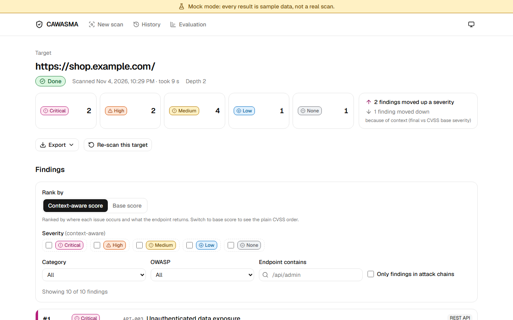
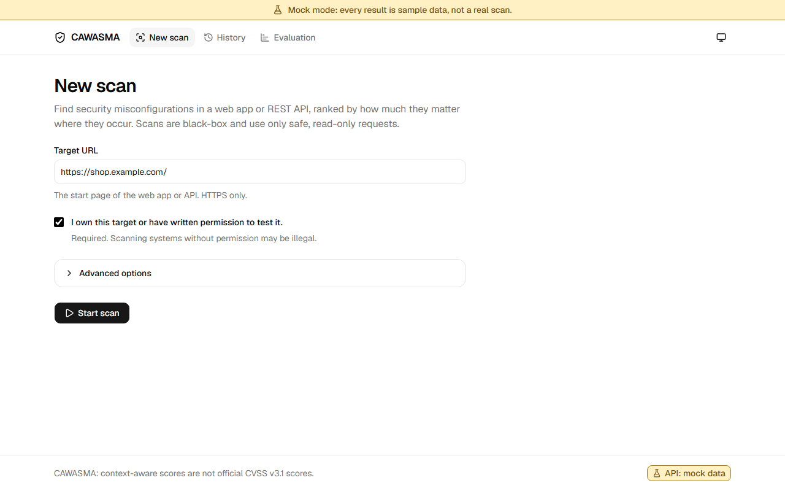
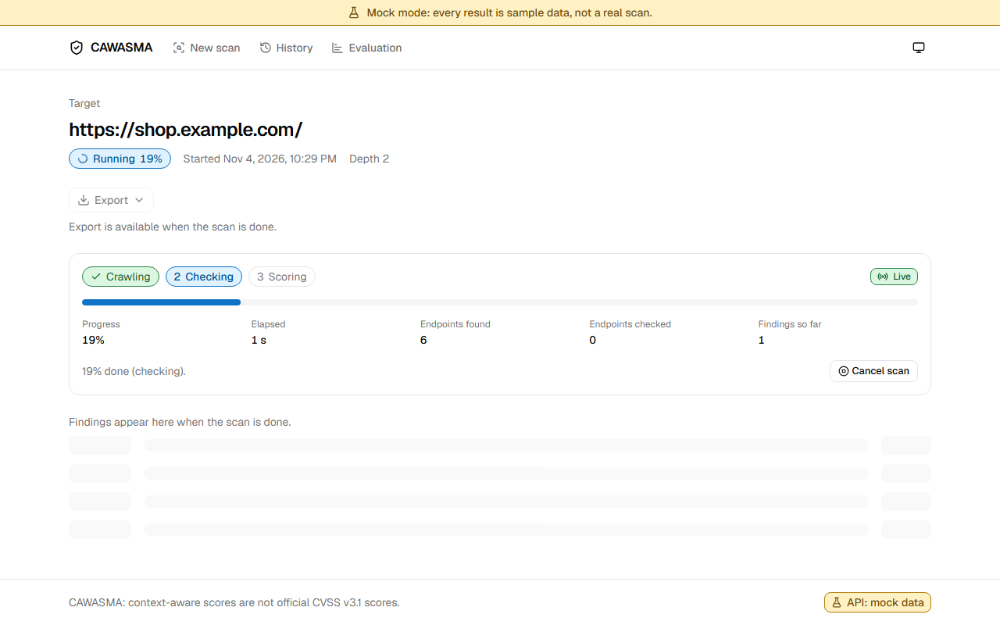
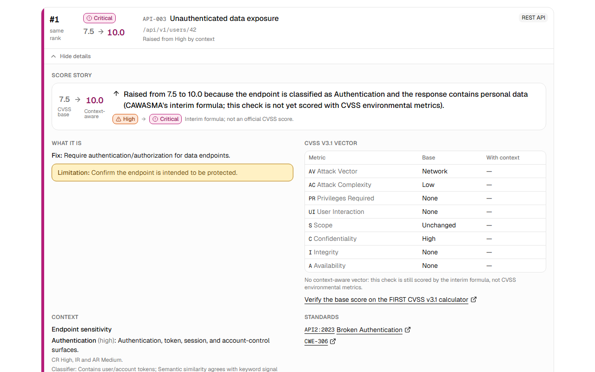
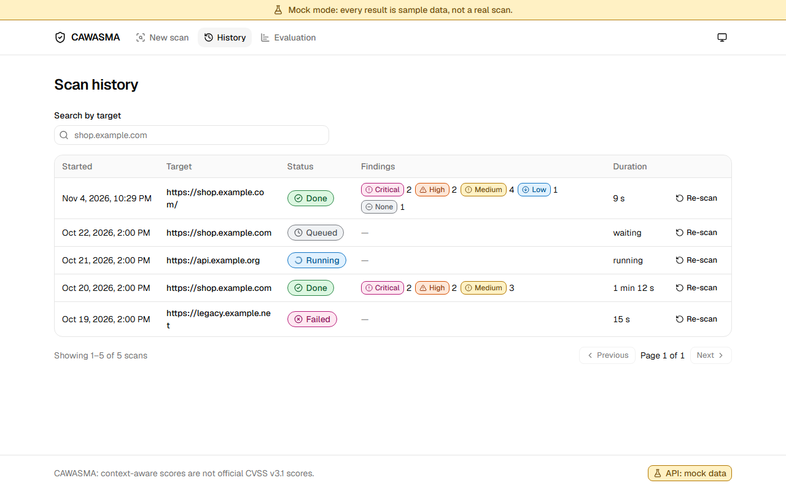
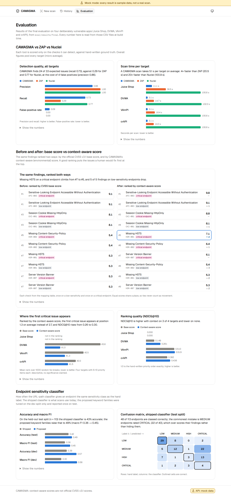
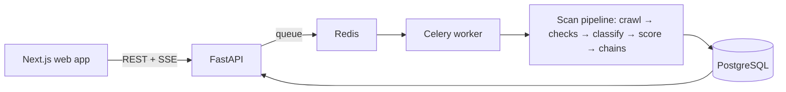

<div align="center">

# CAWASMA

### Context-Aware Web & API Security Misconfiguration Analyzer

**Find the misconfigurations. Understand the context. Prioritise the risk.**

A defensive, black-box security scanner for HTTPS web applications and REST
APIs, built as a BS Computer Science Final Year Project at FAST-NUCES.

<br/>


</div>



> **Authorised testing only.** Scan only systems you own or have written
> permission to test. CAWASMA sends bounded, non-destructive requests (mostly
> `GET`, `HEAD`, `OPTIONS`) to HTTPS targets, refuses private addresses, and
> redacts secrets before anything is stored. It does not exploit anything.

## What CAWASMA is

You give CAWASMA an HTTPS URL. It discovers the site's pages and API routes,
runs 58 misconfiguration checks (security headers, cookies, CORS, TLS, REST
API behaviour, authentication, information disclosure), and returns a
**ranked** report: what to fix first, and why. Related findings are grouped
into attack chains, and every report exports as PDF, HTML, JSON or CSV.

The point is **prioritisation, not detection**: most scanners can tell you a
header is missing; CAWASMA tells you whether that matters more on this
endpoint than on that one.

## Context-aware scoring in three sentences

Every check carries a fixed, official **CVSS v3.1 base score**, which is the
same wherever the problem occurs. CAWASMA then classifies each endpoint's
sensitivity from its URL (an NLP model over the path: `/api/auth/login` is not
`/about`) and scans its response for credentials, personal, financial or
internal data. Those two signals set the CVSS v3.1 **environmental** metrics
(confidentiality, integrity and availability requirements), so the same
missing header scores higher on a login API than on a brochure page, and both
scores are always shown side by side.

Details: [docs/06-scoring-model.md](docs/06-scoring-model.md) and
[docs/cvss-mapping.md](docs/cvss-mapping.md). The 20 checks with a reviewed
spec are scored this way today; the rest still use an interim formula and say
so in the report ([docs/check-coverage.md](docs/check-coverage.md)).

## Screenshots

| | |
|---|---|
|  **1. Enter a URL** and confirm you are authorised |  **2. Watch it run**: stages and counts stream live |
|  **3. The ranked report**, by context-aware score |  **4. Why it scored that way**: base vs context, the vector, the evidence |
|  **5. History** of every scan, with re-scan |  **6. Evaluation**: CAWASMA vs ZAP vs Nuclei |

The screenshots and a demo video are recorded by a script, so they are easy to
regenerate after a UI change: `cd frontend && npm run demo:record` (mock data,
no backend) or `DEMO_REAL=1 npm run demo:record` (through the real API). The
video lands in `frontend/demo-output/cawasma-demo.webm`.

## Quick start

Needs only **Docker** (with Compose v2) and **git**.

```bash
git clone https://github.com/Asimshakeel13/Context-Aware-Web-and-API-Security-Misconfiguration-Analyzer.git cawasma
cd cawasma
docker compose -f docker-compose.yml -f docker-compose.demo.yml --profile frontend up -d --build --wait
```

That one command builds and starts everything: the web app, the API, the
Celery worker, PostgreSQL, Redis, and a small **demo target** to scan. The
first build takes several minutes (it downloads the NLP model; set
`INSTALL_ML=false` for a smaller image that uses the built-in classifiers).

| | |
|---|---|
| Web app | http://localhost:3000 |
| API health | http://localhost:8000/health |
| API docs (Swagger) | http://localhost:8000/docs |

Stop with the same command ending in `down` (add `-v` to delete the database).

> If you created a `.env` from `.env.example`, the web app port is its
> `FRONTEND_HOST_PORT`.

## Run a scan

**In the web app** (http://localhost:3000):

1. Enter `https://demo-target:8443/` (the demo target; any HTTPS site you are
   allowed to test works too).
2. Tick *I own this target or have written permission to test it* and press **Start scan**.
3. Watch the progress; the report opens when the scan is done.
4. Expand a finding to see why it scored as it did, filter by severity or
   category, then **Export** as PDF, HTML, JSON or CSV.
5. **History** lists every scan, with a re-scan button.

The demo target has every security header except HSTS, so the scan reports one
finding, `HDR-001` *Missing HSTS*. It is reachable only from inside the stack,
which is all the scanner needs.

**Through the API:**

```bash
curl -s -X POST http://localhost:8000/api/scan -H 'Content-Type: application/json' \
  -d '{"url": "https://demo-target:8443/", "authorisation_confirmed": true}'
# -> 202 {"scan_id": "...", "status": "QUEUED", ...}

curl -sN http://localhost:8000/api/scan/<scan_id>/events          # live status (SSE)
curl -s  http://localhost:8000/api/results/<scan_id>              # ranked results
curl -s -o report.pdf "http://localhost:8000/api/results/<scan_id>/export?format=pdf"
```

Full reference: [docs/api-contract.md](docs/api-contract.md) (machine-readable:
[docs/openapi.json](docs/openapi.json)). To check that a fresh clone
builds and scans on a clean machine, run `scripts/clean_machine_check.sh`.

## Run the evaluation

CAWASMA is compared with OWASP ZAP and Nuclei on four deliberately vulnerable
apps (OWASP Juice Shop, DVWA, VAmPI, crAPI) that run on an isolated Docker
network, scored against hand-written ground truth.

```bash
make eval-up        # start the four targets (pinned images, no internet route)
make eval           # scan them with CAWASMA, ZAP and Nuclei; score (~20-40 min)
make eval-down
```

Raw outputs and per-run metrics go to `eval/results/`. The final tables for the
report (tool comparison, the before/after ranking experiment, classifier
accuracy) are written to `eval/results/final/` by
`eval/harness/final_tables.py`; see [eval/harness/README.md](eval/harness/README.md)
and [docs/evaluation-method.md](docs/evaluation-method.md).

The web app's **Evaluation** page (http://localhost:3000/evaluation) charts
those tables. It reads the CSVs at build time, so after a new run:
`cd frontend && npm run sync:eval` and rebuild.

## Team and roles

| Member | Role | Owns |
|---|---|---|
| **Atta Ur Rehman** | Backend & scanner engine | FastAPI, the async scan engine and crawler, the check functions, CVSS scoring, attack chains, reports, Celery, database and migrations, Docker and CI |
| **Neelam Jabeen** | Frontend | The Next.js web app: new scan, live status, ranked results and finding detail, history, export, the evaluation page, accessibility and end-to-end tests |
| **Asim Shakeel** | Check specs, CVSS mapping, ML & evaluation | The 58 check specs and their CVSS v3.1 vectors, the environmental mapping, chain templates, the sensitivity and response classifiers, the evaluation lab and harness |

Each area has an owner who reviews changes to it (`.github/CODEOWNERS`);
working rules are in [CLAUDE.md](CLAUDE.md).

## How it is built



| Part | Technology |
|---|---|
| Web app | Next.js 16, React 19, TypeScript, Tailwind CSS, TanStack Query |
| API and scanner | Python 3.12, FastAPI, httpx, SQLAlchemy, Alembic, Celery, Redis |
| Scoring | CVSS v3.1 (`cvss` library) with environmental metrics |
| NLP | Sentence Transformers (`all-MiniLM-L6-v2`), spaCy, regular expressions |
| TLS | SSLyze |
| Reports | JSON, CSV, HTML, PDF (WeasyPrint) |
| Tests | pytest, Vitest, Playwright (with axe accessibility checks) |

```text
backend/    FastAPI app, scanner core (DB-free), workers, migrations, tests
frontend/   Next.js web app, unit and end-to-end tests
config/     check specs, CVSS mapping, chain templates
eval/       evaluation targets, ground truth, labels, harness, results
docs/       design, scoring, API, schema, evaluation method
```

## Scope and limitations

- **In scope:** HTTPS web apps and JSON REST APIs, black-box, without source code.
- **Not covered:** SOAP, gRPC, WebSocket testing, plain-HTTP targets, full
  GraphQL analysis, and anything that needs business-logic knowledge.
- Some issues (BOLA/IDOR, mass assignment) can only be flagged as
  *indicators* without test accounts; the report says which.
- Context-aware scores are CAWASMA's, not official CVSS scores; the official
  base score is always kept and shown next to them.

More: [docs/10-limitations-owasp.md](docs/10-limitations-owasp.md).

## Documentation

Start at [docs/README.md](docs/README.md). Key pages:
[overview](docs/01-overview.md) ·
[architecture](docs/02-architecture.md) ·
[installation](docs/03-installation.md) ·
[security checks](docs/05-security-checks.md) ·
[scoring model](docs/06-scoring-model.md) ·
[attack chains](docs/09-attack-chains.md) ·
[database schema](docs/08-database-schema.md) ·
[viva guide](docs/11-viva-guide.md)

## Development

```bash
make up && make test && make lint            # backend (see make help)
cd frontend && npm ci && npm run dev         # web app on :3000 (see the frontend section of CLAUDE.md)
```
